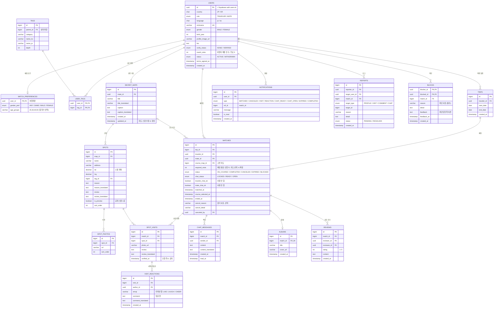

# 서울메이트 ERD v2.6 (11/27, 요구사항정의서 v3.5 · API 명세서 v1.8 · DB 마이그레이션 V1~V3 기준)

> Supabase Postgres 기준. 테이블 17개. 로그인 정보(이메일·비밀번호)는 Supabase Auth(auth.users)가 관리하고, 이 문서의 USERS는 서비스용 회원 정보다.

- **실제 DB가 기준이다.** 테이블은 Flyway 마이그레이션(`server/src/main/resources/db/migration`)이 만들고, 이 문서는 그 내용을 사람이 읽기 쉽게 옮긴 것이다. 11/27 Supabase에 V1~V3 적용을 확인했다.
- `02-erd.png` 그림은 v2.5 기준이다. 아래 0-C의 변경은 그림에 아직 없다.

---

## 0-C. v2.5 → v2.6 변경 (API v1.7 · 화면 명세 v9 반영, V2 · V3 마이그레이션)

| 변경 | 이유 |
| --- | --- |
| SECRET_MAPS.**title_translated** 추가 | 여행자에게 지도 제목을 일본어로 보여 줌 (MAP-07 · 08) |
| MATCHES.**cancel_reason, cancel_detail, canceled_by** 추가 | 매칭 끊기 사유(선택)와 끊은 사람 (MATCH-07, 여행자 · 메이트 모두 가능) |
| MATCHES 인덱스 (traveler_id, course_map_id) 추가 | 같은 지도 중복 선택 확인 (`MAP_ALREADY_SELECTED`) |
| MATCHES.status: 처음부터 **ON_COURSE** | 지도를 고르는 순간 매칭 + 코스 확정. MATCHED는 값으로만 남고 쓰지 않음 |
| MATCHES.chat_status: LOCKED / **READY** / OPEN | 필요 인증 수 달성 → READY, 여행자가 열면 바로 OPEN (수락 단계 없음) |
| MATCHES.traveler_chat_ok · mate_chat_ok **사용 안 함** | 데이터 호환을 위해 칼럼만 남김 |
| required_visits = **내림** (floor) | 5곳 → 2, 6곳 → 3, 7곳 → 3. 지도 선택 시 확정 |
| VISIT_REACTIONS를 행 종류로 구분 | emoji가 있는 행 = 리액션 (방문 기록당 1개, LIKE · LAUGH · CHEER), comment가 있는 행 = 댓글. 테이블 변경 없음 |
| NOTIFICATIONS.type: CHAT_REQUEST → **CHAT_READY** | 채팅 열기 가능 알림 (여행자에게만) |
| TAGS.**category** 사용, V3 시드 | 분류 7개(FOOD · WALK · CULTURE · SHOP · SPORTS · WELLNESS · AREA) + 항목 30개. AREA는 메이트의 "잘 아는 동네" |
| USERS.nickname 2~**8**자 | 화면 명세 v9 |

---

## 0-B. v2.4 → v2.5 변경 (11/25 회의 반영)

| 변경 | 이유 |
| --- | --- |
| USERS.match_slots 기본값 1 → **5** (최대 5) | 유료화 제외, 여행자 무료 5칸 |
| BLOCKS에 **reason, detail** 추가 | 차단은 언제든 가능, 사유 필수 |
| BLOCKS에 **feedback, feedback_at** 추가 | 차단으로 매칭이 끝난 쪽의 의견 (부당한 차단을 가려내기 위한 기록) |
| 설정값 FREE_MATCH_SLOTS(1) → MAX_MATCH_SLOTS(5) | |

---

## 0-A. v2.3 → v2.4 변경 (기술 스택 확정: Supabase + Spring Boot)

| 변경 | 이유 |
| --- | --- |
| USERS.id를 bigint → **uuid**로, 값은 Supabase 회원 id(auth.users.id)와 동일 | 로그인은 Supabase Auth가 담당. 토큰의 sub(회원 id)로 바로 USERS를 찾기 위해 |
| USERS.email, password_hash 삭제 | 이메일·비밀번호는 Supabase Auth가 저장·암호화. 이메일은 토큰에서 읽음 |
| 사용자를 가리키는 모든 FK를 uuid로 변경 | user_id, traveler_id, mate_id, author_id, sender_id, reviewer_id, reviewee_id, reporter_id, target_user_id, blocker_id, blocked_id |
| 모든 테이블에 RLS를 켜고 허용 정책은 만들지 않음 | 앱에 들어가는 Supabase 공개 키로 테이블을 직접 읽지 못하게. 데이터는 Spring 서버(테이블 소유자 권한)로만 읽고 씀 |

---

## 0-0. v2.2 → v2.3 변경 ("오늘의 추천 3명" → "메이트 찾기" 목록)

| 변경 | 이유 |
| --- | --- |
| RECOMMENDATIONS 삭제 | 날마다 3명을 저장할 필요가 없어짐. 목록은 요청할 때마다 계산 |
| MATCH_PREFERENCES.age_min, age_max → **age_groups** | 연령대를 칩으로 여러 개 고름 (20대와 40대만 고르는 경우처럼 범위로 저장할 수 없음) |
| SECRET_MAPS.updated_at 추가 | "최근 업데이트 순" 정렬. 지도 정보 또는 그 지도의 스팟이 추가·수정되면 갱신 |
| 설정값 DAILY_RECOMMEND_COUNT 삭제, MATE_LIST_PAGE_SIZE(20) 추가 | 인원 제한 없이 20명씩 나눠 불러오기 |

---

## 0-1. v2.1 → v2.2 변경 (채팅·자동 종료 기준 50%로 변경)

| 변경 | 이유 |
| --- | --- |
| MATCHES.required_visits 추가 | 채팅에 필요한 인증 수 = 코스 스팟 수 × 0.5 (올림). 코스를 고를 때 한 번 계산해 저장. 여행 중에 메이트가 스팟을 추가해도 기준이 바뀌지 않게 하기 위해 |
| 설정값 CHAT_UNLOCK_VISITS(5) → CHAT_UNLOCK_RATIO(0.5) | 고정 5곳이 아니라 비율 기준 |

---

## 0-2. v2 → v2.1 변경 (API 명세서 작성 중 반영)

| 변경 | 이유 |
| --- | --- |
| MATCHES.traveler_chat_ok, mate_chat_ok null 허용 | 미응답 / 수락 / 거절 구분 |
| USERS.terms_agreed_at 추가 | 약관 동의 시각 기록 (F-02) |
| NOTIFICATIONS.ref_id = match_id로 통일 | 알림 → 화면 이동을 type + match_id로 처리 |
| 자동 종료 조건 수정 | "채팅 미개설"이 아니라 요구사항(F-24)대로 "인증 수 미달"로 계산 |

---

## 1. v1 → v2 변경 요약

| 변경 | 내용 | 관련 요구사항 |
| --- | --- | --- |
| MATCH_PROPOSALS 삭제 → **RECOMMENDATIONS** 추가 | "리매치" 대신 "오늘의 추천 3명"을 날짜별로 저장 | F-15, F-16 |
| USERS에 **match_slots** 추가 | 여행자의 매칭 칸 수 (기본 1, 유료로 증가) | F-17, F-18 |
| USERS에 **password_hash, status** 추가 | 로그인, 회원 탈퇴 | F-02, F-03, F-43 |
| USERS.verify_doc 삭제 | 인증 수단이 여권 하나로 정해짐 (MVP는 화면만) | F-04 |
| MATCH_PREFERENCES.max_active_matches 삭제 | 메이트 상한 10명은 모든 메이트 공통이라 서버 설정값으로 이동 | F-23 |
| **MATCHES 크게 변경** | trip_id 1:1 제약 해제(칸이 여러 개면 한 여행에 매칭 여러 건), map_id → course_map_id(코스 선택 전 null), cancel_reason 삭제(여행자는 언제든 취소), 상태에 EXPIRED·BLOCKED 추가, 채팅 양쪽 수락 컬럼 추가 | F-17, F-20, F-21, F-24, F-29, F-30, F-37 |
| TRIPS.status 삭제 | 진행 상태는 MATCHES.status로 관리 (매칭이 여러 건일 수 있어서) | F-09 |
| SPOT_VISITS의 lat, lng, shared_at 삭제 → **verified_at** | 위치 좌표는 저장하지 않음, 인증 즉시 공개 | F-26, F-27 |
| SECRET_MAPS·SPOTS에 **번역 컬럼** 추가 | 메이트가 쓴 캡션·추천 이유·후기를 일본어로 번역해 저장 | F-35 |
| REPORTS에 **target_type, target_id** 추가 | 프로필·방문 기록·댓글·채팅 어디서나 신고 | F-36 |
| BLOCKS에 **match_id** 추가 | 채팅창에서 차단 → 해당 매칭 종료 | F-37 |
| PUSH_TOKENS 삭제 | 푸시 알림은 선택 기능(F-OPT-03). 필요해지면 다시 추가 | F-39 |

---

## 2. ERD

(Notion에서 코드 블록 언어를 Mermaid로 바꾸면 그림으로 보입니다. 이미지 파일도 함께 첨부)

---

## 3. 정책이 DB에서 어떻게 계산되나

| 정책 | 계산 방법 |
| --- | --- |
| 여행자 빈 칸 수 | `USERS.match_slots`(기본 5) − 진행 중 매칭 수 (MATCHES.status = ON_COURSE) |
| 메이트 정원 (10건) | 진행 중 매칭 수가 10 미만인 메이트의 지도만 지도 고르기 목록에 표시 |
| 지도 공개 조건 | 스팟 5곳 이상 + is_preview 정확히 2곳 |
| 목록 제외 대상 | 차단 관계(BLOCKS, 양방향), 정원 초과, 공개 조건 미달, 탈퇴. 내가 이미 고른 지도는 조건과 상관없이 표시(`myMatchId`) |
| 매칭 조건 거르기 | gender_pref와 USERS.gender 비교, age_groups에 메이트 연령대 포함 여부 (만 18~19세는 20대로 계산) |
| 추천순 (기본) | 여행자와 메이트의 USER_TAGS 중 겹치는 tag 수가 많은 순 → 최근 업데이트 → 지도 id |
| 핀 개수 | 지도 하나의 SPOTS 개수 (카드 1장 = 지도 1개) |
| 최근 업데이트 순 | SECRET_MAPS.updated_at |
| 인기순 | 그 지도가 선택된 누적 횟수 (MATCHES.course_map_id = 지도 id인 행 수, 상태 무관) |
| 필요 인증 수 | 지도 선택 시 `required_visits = floor(SPOTS 개수 × 0.5)` 저장 (5곳 → 2, 6곳 → 3, 7곳 → 3) |
| 진행률 | 해당 매칭의 SPOT_VISITS 개수 / 코스 지도 SPOTS 개수 |
| 채팅 열기 가능 | SPOT_VISITS 개수가 required_visits에 처음 도달 → chat_status = READY + 여행자에게 CHAT_READY 알림 |
| 채팅 열림 | 여행자가 열면 바로 chat_status = OPEN + 메이트에게 CHAT_OPEN 알림 |
| 자동 종료 (매일 00:10) | TRIPS.end_date < 오늘 + status = ON_COURSE + SPOT_VISITS 개수 < required_visits → status = EXPIRED + ALBUMS 1행 생성 |
| 자동 완료 (같은 배치) | TRIPS.end_date < 오늘 + status = ON_COURSE + SPOT_VISITS 개수 ≥ required_visits → status = COMPLETED + ALBUMS 1행 생성 (제목 = 지도 이름, 표지 = 첫 인증 사진) |
| 차단 | BLOCKS 저장(사유 필수) + 진행 중이면 해당 MATCHES.status = BLOCKED, 칸 반환. 채팅 여부와 상관없이 언제든 |
| 차단 피드백 | 차단당한 쪽이 BLOCKS.feedback에 1회 저장 (feedback이 null일 때만) |

---

## 4. 중복 방지 제약 (Unique)

| 테이블 | Unique 키 | 막는 것 |
| --- | --- | --- |
| USERS | nickname | 닉네임 중복 (이메일 중복은 Supabase Auth가 막음) |
| SPOT_VISITS | (match_id, spot_id) | 같은 스팟 중복 인증 |
| ALBUMS | match_id | 매칭 1건에 앨범 여러 개 |
| REVIEWS | (match_id, reviewer_id) | 같은 매칭에 후기 여러 번 |
| REPORTS | (reporter_id, match_id, target_user_id) | 같은 상대 중복 신고 |
| BLOCKS | (blocker_id, blocked_id) | 중복 차단 |

※ "공개 스팟은 지도당 2곳", "취향은 1~14개 · 분류당 2개", "리액션은 방문 기록당 1개"는 DB 제약이 아니라 서버 코드에서 검사합니다.

---

## 5. 서버 설정값 (정책 상수)

코드 곳곳에 숫자를 직접 쓰지 않고 한곳에 모아 두면, 정책이 바뀌어도 한 줄만 고치면 됩니다.

| 이름 | 값 | 의미 |
| --- | --- | --- |
| MAP_LIST_PAGE_SIZE | 20 | 지도 고르기 목록을 한 번에 불러오는 지도 수 (size 1~50) |
| MATE_MAX_ACTIVE_MATCHES | 10 | 메이트 동시 매칭 상한 |
| MAP_MIN_SPOTS | 5 | 지도 공개 최소 스팟 수 |
| MAP_PREVIEW_SPOTS | 2 | 공개 스팟 수 |
| CHAT_UNLOCK_RATIO | 0.5 | 채팅 열기에 필요한 인증 비율 (코스 스팟 수 × 0.5, 내림) |
| VISIT_RADIUS_METERS | 200 | 방문 인증 반경 |
| MAX_MATCH_SLOTS | 5 | 여행자 매칭 칸 (무료) |
| MAX_TAGS | 14 | 취향 최대 개수 (분류당 2개: 6분류 × 2 + 동네 2). 최신 디자인은 제한 없음 → API 명세서 6장 16번 |
| MIN_AGE | 18 | 가입 최소 나이 |

---

## 6. 테이블 정의

### USERS (사용자)
| 컬럼 | 타입 | 설명 |
| --- | --- | --- |
| id | uuid PK | Supabase 회원 id(auth.users.id)와 같은 값 |
| country | char | JP / KR. 국적 선택 결과 |
| role | enum | TRAVELER(JP) / MATE(KR). country로 자동 지정 |
| language | char | ja / ko. 화면 언어, 번역 방향 |
| nickname | varchar UK | 2~8자 |
| gender | enum | MALE / FEMALE |
| birth_year | int | 연령대 계산, 만 18세 이상 |
| profile_image_url, bio | | 프로필 |
| verify_status | enum | NONE / VERIFIED (MVP는 업로드하면 VERIFIED) |
| match_slots | int | 여행자의 매칭 칸 수. 기본 5 (무료, 최대 5) |
| status | enum | ACTIVE / WITHDRAWN |
| terms_agreed_at | timestamp | 약관 동의 시각 |

### MATCH_PREFERENCES (여행자의 매칭 조건)
| 컬럼 | 타입 | 설명 |
| --- | --- | --- |
| user_id | uuid PK, FK | 여행자 1명당 1개 |
| gender_pref | enum | ANY / SAME / MALE / FEMALE |
| age_groups | varchar | 원하는 메이트 연령대 목록. 예: "20,30" (20 = 20대, 50 = 50대 이상). 1개 이상 |

### TAGS / USER_TAGS (취향)
| 컬럼 | 타입 | 설명 |
| --- | --- | --- |
| TAGS.parent_id | bigint FK | 상위 취향 (카페 → 조용한 카페). 최상위는 null |
| TAGS.name_ko, name_ja | varchar | 언어별 표시 이름 |
| TAGS.category | varchar | 분류 코드 FOOD / WALK / CULTURE / SHOP / SPORTS / WELLNESS / AREA(동네) |
| TAGS.depth | int | 1 = 대분류, 2 = 항목 (3단계 세부는 결선 버전에 없음) |
| USER_TAGS.(user_id, tag_id) | 복합 PK | 여행자는 여행 취향, 메이트는 추천 가능한 취향·동네 |

### TRIPS (여행 일정)
| 컬럼 | 타입 | 설명 |
| --- | --- | --- |
| traveler_id | uuid FK | |
| start_date, end_date | date | 방한 일정. end_date는 자동 종료·자동 완료 판단에 사용 |

### SECRET_MAPS / SPOTS / SPOT_PHOTOS (비밀지도)
| 컬럼 | 타입 | 설명 |
| --- | --- | --- |
| SECRET_MAPS.mate_id | uuid FK | 한 메이트가 여러 지도 생성 |
| SECRET_MAPS.title, caption | | 지도 이름과 캡션 |
| SECRET_MAPS.title_translated | varchar | 지도 이름 일본어 번역 |
| SECRET_MAPS.caption_translated | text | 일본어 번역 |
| SECRET_MAPS.updated_at | timestamp | 지도·스팟이 추가·수정된 마지막 시각 ("최근 업데이트 순") |
| SPOTS.lat, lng | decimal | **스팟의 위치** (방문 인증 반경 계산 기준). 여행자 위치가 아님 |
| SPOTS.reason, review | text | 추천 이유, 메이트 후기 |
| SPOTS.*_translated | text | 일본어 번역 |
| SPOTS.is_preview | boolean | 매칭 전에도 여행자에게 보이는 공개 스팟 2곳 (메이트가 지정) |
| SPOT_PHOTOS.url | varchar | 스팟 사진 1~3장 |

### MATCHES (매칭)
| 컬럼 | 타입 | 설명 |
| --- | --- | --- |
| trip_id | bigint FK | 칸이 여러 개면 한 여행에 매칭 여러 건 가능 |
| traveler_id, mate_id | uuid FK | |
| course_map_id | bigint FK | 여행자가 고른 지도 (지도 1개 = 매칭 1개) |
| status | enum | ON_COURSE(여행 중, 지도 선택 즉시) → COMPLETED(여행 완료 또는 자동 완료) / CANCELED(매칭 끊기, 여행자 · 메이트) / EXPIRED(기간 만료, 인증 50% 미만) / BLOCKED(차단). MATCHED는 쓰지 않음 |
| required_visits | int | 채팅에 필요한 인증 수. 지도 선택 시 확정 (내림) |
| chat_status | enum | LOCKED → READY(필요 인증 수 달성) → OPEN(여행자가 열면 바로) |
| traveler_chat_ok, mate_chat_ok | boolean (null 허용) | v1.7부터 사용 안 함 (칼럼만 남김) |
| cancel_reason, cancel_detail, canceled_by | varchar, varchar, uuid FK | 매칭 끊기 사유(선택, 7종)와 상세, 끊은 사람 |
| matched_at, course_selected_at, ended_at | timestamp | |

### SPOT_VISITS / VISIT_REACTIONS (방문 인증과 리액션)
| 컬럼 | 타입 | 설명 |
| --- | --- | --- |
| SPOT_VISITS.match_id, spot_id | bigint FK | (match_id, spot_id) Unique |
| SPOT_VISITS.photo_url, review | | 인증 사진과 후기 |
| SPOT_VISITS.review_translated | text | 메이트가 볼 한국어 번역 |
| SPOT_VISITS.verified_at | timestamp | 인증 시각 = 메이트 공개 시각. **여행자 위치는 저장하지 않음** |
| VISIT_REACTIONS.author_id | uuid FK | 메이트 |
| VISIT_REACTIONS.emoji | varchar | 리액션 행: LIKE / LAUGH / CHEER, 방문 기록당 1개 (바꾸기 · 해제 가능) |
| VISIT_REACTIONS.comment, comment_translated | text | 댓글 행: 댓글과 일본어 번역. 리액션 · 댓글 모두 앨범에 들어감 |

### CHAT_MESSAGES (쪽지)
| 컬럼 | 타입 | 설명 |
| --- | --- | --- |
| match_id | bigint FK, sender_id | uuid FK | chat_status = OPEN일 때만 저장 가능 |
| content, content_translated | text | 원문과 번역 |
| created_at, read_at | timestamp | |

### ALBUMS / REVIEWS (여행 후)
| 컬럼 | 타입 | 설명 |
| --- | --- | --- |
| ALBUMS.match_id | bigint FK, UK | 앨범 내용은 SPOT_VISITS·VISIT_REACTIONS에서 불러와 보여 줌 |
| ALBUMS.title, cover_url | | 제목과 표지 |
| REVIEWS.reviewer_id, reviewee_id | uuid FK | 서로에 대한 후기 |
| REVIEWS.rating | int | 1~5 |

### NOTIFICATIONS (앱 안 알림)
| 컬럼 | 타입 | 설명 |
| --- | --- | --- |
| type | enum | MATCHED / CANCELED / VISIT / REACTION / CHAT_READY / CHAT_OPEN / EXPIRED / COMPLETED |
| ref_id | bigint | 관련 매칭 id(match_id). 앱은 type + match_id로 이동할 화면을 정함 |
| message, is_read | | |

### REPORTS / BLOCKS (안전)
| 컬럼 | 타입 | 설명 |
| --- | --- | --- |
| REPORTS.target_type, target_id | | 무엇을 신고했는지 (PROFILE / VISIT / COMMENT / CHAT) |
| REPORTS.reason, detail, status | | 사유, 상세, 처리 상태 |
| BLOCKS.(blocker_id, blocked_id) | 복합 PK | 차단 관계. 이후 지도 고르기 목록에서 서로 제외 |
| BLOCKS.match_id | bigint FK | 어느 매칭에서 차단했는지 |
| BLOCKS.reason, detail | | 차단 사유(ABUSIVE / CONTACT_REQUEST / FORCED_MEETING / SEXUAL / SPAM / OTHER, 신고와 같은 목록, 필수)와 상세 |
| BLOCKS.feedback, feedback_at | | 차단당한 쪽의 의견. MVP는 저장만, 판단·불이익은 확장 기능 |

---

## 7. 요구사항 ↔ 테이블 대응

| 요구사항 | 테이블 |
| --- | --- |
| F-01~F-06 (국적·가입·인증·프로필) | USERS |
| F-07 (취향) | TAGS, USER_TAGS |
| F-08 (매칭 조건) | MATCH_PREFERENCES |
| F-09 (여행 일정) | TRIPS |
| F-10~F-14 (비밀지도) | SECRET_MAPS, SPOTS, SPOT_PHOTOS |
| F-15, F-16 (지도 고르기 · 공개 스팟 미리보기) | 저장 테이블 없음. USERS, USER_TAGS, MATCH_PREFERENCES, SECRET_MAPS, SPOTS, MATCHES, BLOCKS로 요청 시 계산 |
| F-17~F-24 (매칭·칸·취소·상한·자동 종료·자동 완료) | MATCHES, USERS.match_slots |
| F-25~F-28 (탐방·인증·리액션) | SPOT_VISITS, VISIT_REACTIONS |
| F-29~F-31 (채팅) | MATCHES.chat_*, CHAT_MESSAGES |
| F-32~F-34 (완료·앨범·후기) | MATCHES, ALBUMS, REVIEWS |
| F-35 (AI 번역) | 각 테이블의 *_translated 컬럼 |
| F-36~F-38, F-44 (신고·차단·개인정보·차단 피드백) | REPORTS, BLOCKS |
| F-39 (알림) | NOTIFICATIONS |
| F-43 (탈퇴) | USERS.status |
